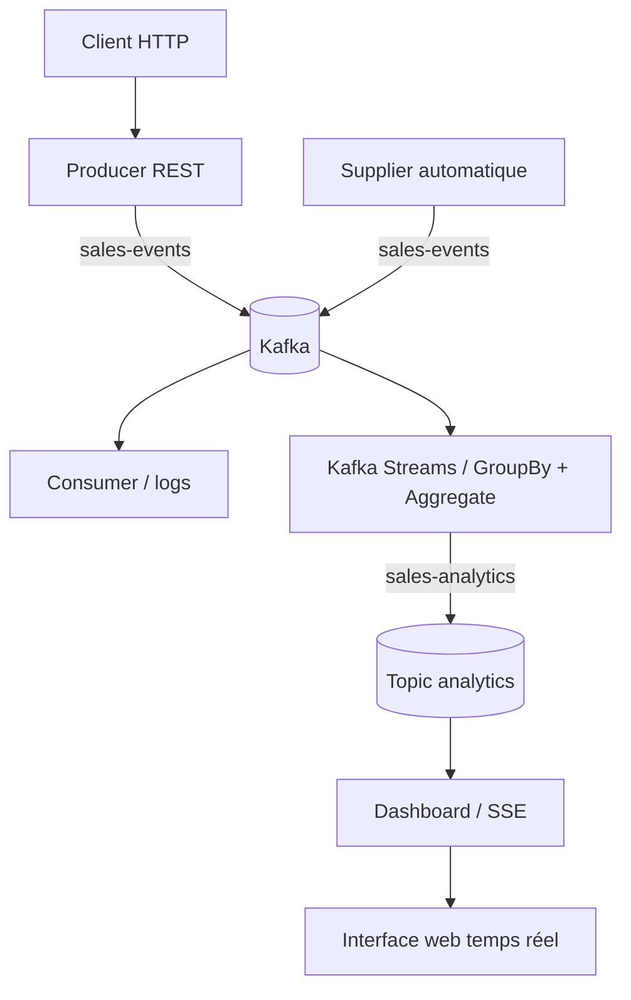

# Rapport — Activité pratique N°3 : Event Driven Architecture

**École :** ENSET — II-BDCC3  
**Module :** Systèmes Distribués et DevOps  
**Enseignant :** Mohamed YOUSSFI  
**Étudiant :** [Nom à compléter]  
**Année :** 2026–2027

## 1. Contexte

L'énoncé publié dans Google Classroom le 19 octobre 2026 demande de : (1) démarrer ZooKeeper et Kafka localement, puis tester la CLI producer/consumer ; (2) reproduire ce fonctionnement avec Docker Compose ; (3) construire des services Producer, Consumer, Supplier, un traitement de données en temps réel avec Kafka Streams, et une application Web affichant les résultats.

Ce projet propose un suivi de **ventes** en continu (montants en MAD) pour illustrer les principes d'architecture pilotée par les événements.

## 2. Objectifs

- Découpler les services via des messages Kafka.
- Vérifier un flux message producer → topic → consumer, avec et sans Docker.
- Exposer une API REST productrice de messages avec Spring Cloud Stream / `StreamBridge`.
- Consommer des ventes de façon indépendante, sans appel HTTP synchrone.
- Émettre périodiquement des ventes de démonstration avec `Supplier`.
- Agréger les ventes par produit via une topologie Kafka Streams à état (state store).
- Visualiser les résultats par SSE dans un navigateur.

## 3. Architecture

Le **topic `sales-events`** contient des événements métier JSON (identifiant, produit, région, quantité, prix unitaire, horodatage). Le **topic `sales-analytics`** transporte des instantanés cumulatifs par produit (commandes, unités, chiffre d'affaires). La couche web tient une projection en mémoire et pousse les changements via SSE.

## 4. Partie 1 — Installation Kafka / ZooKeeper

Étapes requises : démarrer ZooKeeper ; démarrer le broker Kafka ; créer un topic de test ; ouvrir un producteur console et un consommateur console ; échanger un message.

**À joindre :** Capture A — ZooKeeper actif ; Capture B — broker actif ; Capture C — message produit puis reçu. Les commandes exactes sont dans le README.

## 5. Partie 2 — Docker Compose

Le fichier `docker-compose.yml` définit deux conteneurs centraux : `zookeeper` et `broker`. Le broker annonce deux listeners : `localhost:9092` pour l'hôte et `broker:29092` pour les clients sur le réseau Docker. Les services Spring optionnels sont dans le profil `full`.

**À joindre :** Capture D — `docker compose ps` ; Capture E — échanges console producer/consumer dans le broker.

## 6. Partie 3 — Microservices Spring Cloud Stream

| Composant | Rôle | Mécanisme |
|---|---|---|
| Producer | Publier une vente valide via HTTP | `StreamBridge.send` |
| Consumer | Tracer chaque vente, exposer un compteur | `Consumer<String>` |
| Supplier | Générer une vente toutes les ~8 s | `Supplier<String>` / poller |
| Analytics | Agréger le nombre de ventes, les unités et le CA | `KStream.groupByKey().aggregate()` |
| Dashboard | Conserver et présenter les dernières valeurs | `Consumer<String>` + SSE |

### Exemple de calcul théorique

Un événement `Laptop, q=2, PU=6500 MAD` donne un CA incrémental de **13 000 MAD**. Un événement ultérieur `Laptop, q=1, PU=6500 MAD` porte le compteur à **2 commandes**, **3 unités**, **19 500 MAD**.

Les valeurs du tableau sont un **résultat attendu**, pas un résultat observé. Les données issues du Supplier peuvent changer les totaux pendant l'exécution.

## 7. Tests à exécuter avant remise

- [ ] `mvn clean test` réussit dans IntelliJ / terminal.
- [ ] `docker compose up -d` démarre Kafka et ZooKeeper.
- [ ] Console producer → consumer fonctionne.
- [ ] POST `/api/sales` renvoie HTTP 202.
- [ ] Consumer journalise une vente et son compteur progresse.
- [ ] Supplier émet plusieurs ventes périodiques.
- [ ] Dashboard affiche les agrégats mis à jour (SSE).
- [ ] Vérifier agrégats lorsque le Supplier est temporairement arrêté.

**Important :** La compilation, les tests et le démarrage de Kafka **n'ont pas été exécutés** dans l'environnement de génération (Maven et Docker non installés). Le rapport sera complet après ajout de captures d'écran authentiques et résultats locaux.

## 8. Discussion

Kafka permet une communication asynchrone et le découplage producer/consumer. Le consumer et la topologie Kafka Streams lisent indépendamment le même topic avec leurs propres identifiants de groupe/applications. Le magasin d'état Kafka Streams assure des agrégats cumulés par produit. La projection du dashboard est reconstruite des événements du topic analytique si ses offsets sont disponibles. Limites : installation de démonstration mono-broker non sécurisée, aucune déduplication des événements, absence de monitoring, démonstration locale ; ne pas déployer telle quelle en production.

## 9. Conclusion

Cette réalisation regroupe les trois parties de l'activité pratique : test Kafka en ligne de commande, déploiement Docker ZooKeeper/broker, puis architecture Spring Cloud Stream et Kafka Streams avec affichage web en temps réel.

## Références

- Vidéo TP : https://www.youtube.com/watch?v=8uY7JE_X_Fw
- Tutoriel Docker : https://developer.confluent.io/quickstart/kafka-docker/
- Spring Cloud Stream : https://docs.spring.io/spring-cloud-stream/reference/spring-cloud-stream/producing-and-consuming-messages.html
- Kafka Streams binder : https://docs.spring.io/spring-cloud-stream/reference/kafka/kafka-streams-binder/programming-model.html