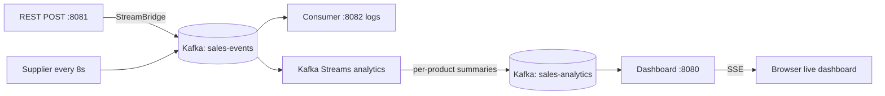

# TP3 — Event Driven Architecture | Kafka · Spring Cloud Stream · Kafka Streams

> **ENSET · II-BDCC3 · Systèmes Distribués et DevOps · Prof. Mohamed YOUSSFI**

Project matching the three-part Google Classroom assignment of **19 October 2026**: Kafka + ZooKeeper CLI; Docker Compose; REST producer, consumer, scheduled supplier, real-time Kafka Streams analytics, and a live web dashboard.

> This is an independent implementation of the written assignment. The demonstration video was referenced but not reproduced frame by frame. **Execution and Maven tests have not been verified in this environment**; check locally before submitting.

## Architecture



| Module | Function | Port |
|---|---|---|
| `common-events` | JSON contracts: `SaleEvent`, `SalesSummary` | — |
| `producer-service` | `POST /api/sales` via StreamBridge | 8081 |
| `consumer-service` | Logs incoming sales + stats API | 8082 |
| `supplier-service` | Automatic demo sales, every 8 seconds | — |
| `analytics-service` | Kafka Streams stateful per-product totals | — |
| `dashboard-service` | Read model API, SSE, web dashboard | 8080 |

## Requirements

Java **21**, Maven **3.9+**, Docker Desktop with Compose (for Kafka), available ports 9092/8080/8081/8082. **Confluent Platform 7.7.13** is pinned because the assignment expressly requires ZooKeeper. Newer Kafka deployments usually use KRaft instead.

## Option A — Run everything in Docker (simplest)

From project root:

```bash
docker compose --profile full up -d --build
docker compose --profile full ps
```

Open **http://localhost:8080**. The supplier automatically publishes test sales every eight seconds. To stop:

```bash
docker compose --profile full down
```

For a clean reset of Kafka data, use `docker compose --profile full down -v` (destructive).

## Option B — Run applications in IntelliJ IDEA

1. Open root `pom.xml` as a Maven project with **JDK 21**.
2. Start broker + ZooKeeper only with `docker compose up -d`.
3. Run the following Spring Boot main classes (each in its own run configuration):
   - `ProducerApplication` (8081)
   - `ConsumerApplication` (8082)
   - `SupplierApplication` (no HTTP port)
   - `AnalyticsApplication` (Kafka Streams)
   - `DashboardApplication` (8080)
4. Open **http://localhost:8080**.
5. Use Postman (collection under `postman/`) or PowerShell commands from `scripts/demo-requests.ps1`.

## Assignment Part 1 — Manual Kafka + ZooKeeper (no Docker)

The following commands target **Kafka 3.8.x**, which retains ZooKeeper support. The exact release varies by platform; download its archive from https://kafka.apache.org/downloads and unpack it.

**Terminal 1** (Kafka root):

```bash
bin/zookeeper-server-start.sh config/zookeeper.properties
```

**Terminal 2**:

```bash
bin/kafka-server-start.sh config/server.properties
```

**Terminal 3 — producer/consumer:**

```bash
bin/kafka-topics.sh --bootstrap-server localhost:9092 --create --topic tp3-console --partitions 1 --replication-factor 1
bin/kafka-console-producer.sh --bootstrap-server localhost:9092 --topic tp3-console
```

**Terminal 4**:

```bash
bin/kafka-console-consumer.sh --bootstrap-server localhost:9092 --topic tp3-console --from-beginning
```

Enter `Bonjour Kafka` into the producer terminal and verify the consumer prints it. Windows Kafka archives use `bin\windows\*.bat` instead of `bin/*.sh`.

## Assignment Part 2 — Kafka with Docker and two containers

```bash
docker compose up -d

docker compose exec broker kafka-topics --bootstrap-server broker:29092 --create --if-not-exists --topic tp3-console --partitions 1 --replication-factor 1

docker compose exec broker kafka-console-consumer --bootstrap-server broker:29092 --topic tp3-console --from-beginning
```

Open a second terminal:

```bash
docker compose exec broker kafka-console-producer --bootstrap-server broker:29092 --topic tp3-console
```

Type one message and observe it in the consumer. Port **9092** is advertised to local IntelliJ applications; Docker-network applications use **broker:29092**. See `scripts/test-kafka.sh` for an automated demo.

## Assignment Part 3 — Spring Cloud Stream services

Send a sale:

```bash
curl -X POST http://localhost:8081/api/sales -H "Content-Type: application/json" -d '{"product":"Laptop","region":"Casablanca","quantity":2,"unitPrice":6500.00}'
```

Expected response: HTTP **202** plus a sale UUID (`queued` means accepted by the message producer, not yet committed to analytics). Inspect:

- **http://localhost:8082/api/consumer/stats** — consumed messages since this instance started
- **http://localhost:8080/api/analytics** — current per-product sums
- **http://localhost:8080/api/stream** — SSE updates
- **http://localhost:8080/** — animated browser dashboard

The aggregate counts orders and sold units, and adds revenue per product. For 2 units of Laptop at 6500 MAD, the revenue contribution is **13000 MAD**. The supplier adds new sales continuously.

## Testing

```bash
mvn clean test
mvn clean package
```

`SalesSummaryTest` covers summation and input checks. Run the end-to-end checks with broker and services started before adding screenshots to the report. **The supplied source has not been proven to compile/run in this environment**, since Maven and Docker were unavailable.

## Resources

- [Class demo video](https://www.youtube.com/watch?v=8uY7JE_X_Fw)
- [Confluent Docker quickstart](https://developer.confluent.io/quickstart/kafka-docker/)
- [Spring Cloud Stream functional model](https://docs.spring.io/spring-cloud-stream/reference/spring-cloud-stream/producing-and-consuming-messages.html)
- [Kafka Streams binder](https://docs.spring.io/spring-cloud-stream/reference/kafka/kafka-streams-binder/programming-model.html)
- [Kafka listeners](https://docs.confluent.io/platform/current/kafka/listeners.html)